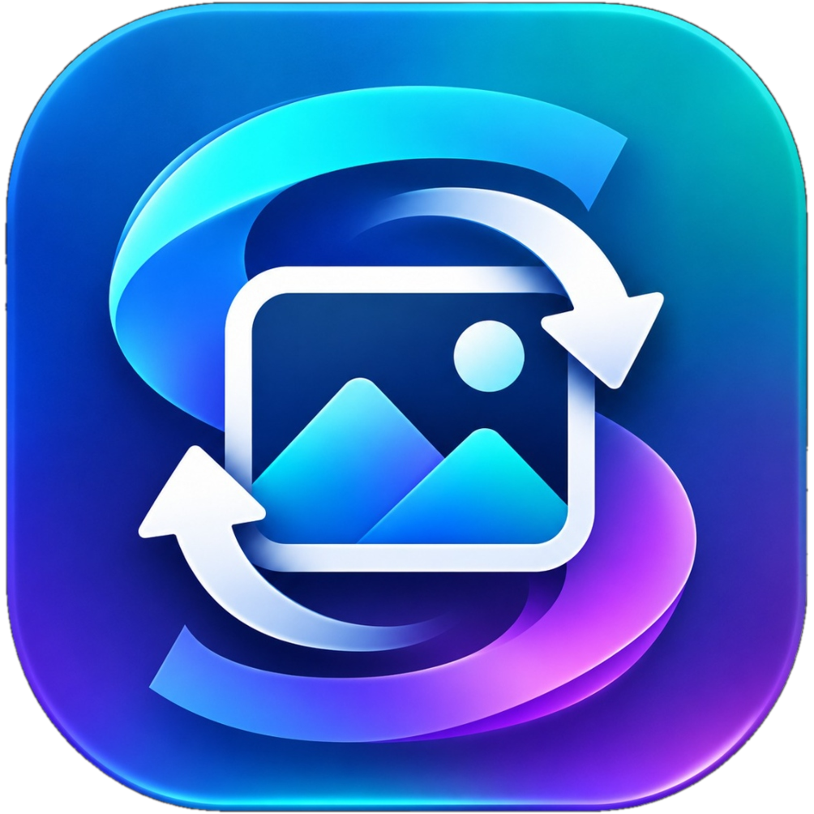

# ⚡ Syed's Image Convertor

**Created by Syed Riyazuddin**  
*A fast, offline, privacy-first local image converter with Windows Explorer right-click context menu integration.*

<p align="center">
  
</p>

<p align="center">
  <a href="https://github.com/syedriyazuddin-work/syeds-image-convertor/releases/latest/download/Syeds-Image-Convertor-Setup.exe">
    
  </a>
  <a href="https://github.com/syedriyazuddin-work/syeds-image-convertor/releases/latest/download/Syeds-Image-Convertor-Portable.zip">
    
  </a>
</p>

---

## 🚀 Features

- **Windows Explorer Right-Click Menu Integration**:
  - Right-click any image (`.png`, `.jpg`, `.jpeg`, `.webp`, `.avif`, `.heic`, `.bmp`, `.gif`, `.tiff`, `.ico`):
    - ⚡ **Convert to WebP (Instant)**
    - ⚡ **Convert to PNG (Instant)**
    - ⚡ **Convert to JPG (Instant)**
    - ⚡ **Convert to AVIF (Instant)**
    - 🎨 **Customize & Convert (GUI)...**
- **100% Offline & Private**:
  - Zero cloud uploads, zero telemetry, zero servers.
  - All processing is performed locally on your machine.
- **Modern Desktop GUI**:
  - Drag and drop single files, multiple photos, or entire folders.
  - Batch processing with real-time progress tracking and space savings indicator.
  - Fine-tuned compression slider (1-100) and Lossless mode for WebP/PNG.
  - Image resizing: Original, proportional scaling (25%, 50%, 75%, 200%), or custom pixel dimensions with aspect ratio locking.
- **Send To Integration**:
  - Accessible via Explorer's **Send to ➔ Syed's Image Convertor**.
- **Non-Intrusive Floating Toasts**:
  - Instant conversions show a subtle dark notification card with a 1-click **"📂 View in Explorer"** shortcut.

---

## 📦 How to Install on Any Windows PC

1. Download **[`Syeds-Image-Convertor-Setup.exe`](https://github.com/syedriyazuddin-work/syeds-image-convertor/releases/latest/download/Syeds-Image-Convertor-Setup.exe)** from the Releases section.
2. Double-click the downloaded setup file.
3. Click **Next ➔ Install** (no Python or admin rights required).
4. Right-click any image on your PC to convert instantly!

---

## 🛠️ Running from Source (Development)

If you wish to run directly from Python source:

```bash
# Clone the repository
git clone https://github.com/syedriyazuddin-work/syeds-image-convertor.git
cd syeds-image-convertor

# Install dependencies
pip install -r requirements.txt

# Run Desktop GUI
python gui.py
```
